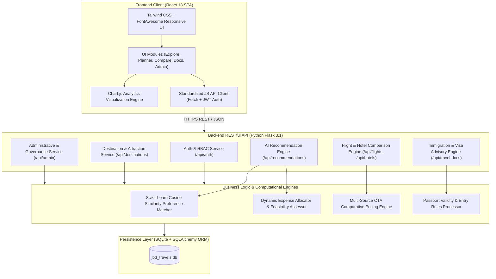
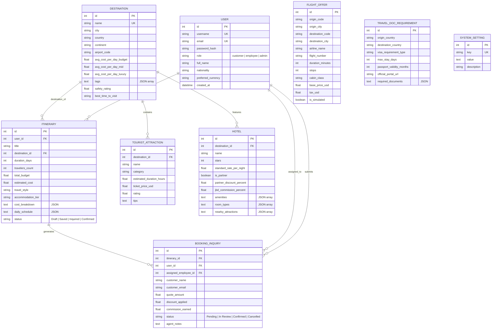

# System Architecture & Technical Design Document

**Project**: AI-Assisted Travel Planning and Management System for JBD Travels  
**Target Organization**: JBD Travels Global Concierge  
**Version**: 2.0.0  

---

## 1. High-Level Architectural Overview

The JBD Travels system is designed around a decoupled, service-oriented web architecture consisting of a responsive React.js Single Page Application (SPA) client communicating with a Python Flask RESTful API service backed by a relational SQLite database.

---

## 2. Database Entity-Relationship (ER) Model

---

## 3. Computational Algorithms & Mathematical Formulas

### 3.1 AI Preference Matching (Cosine Similarity)
The AI recommender transforms user desires and destination profiles into multi-dimensional feature vectors $\vec{u}$ and $\vec{d}$ across feature keys (Adventure, Relaxation, Culture, Nature, Sightseeing, Foodie, Luxury, Nightlife, Beaches, Shopping):

$$\text{Cosine Similarity}(\vec{u}, \vec{d}) = \frac{\vec{u} \cdot \vec{d}}{\|\vec{u}\|_2 \|\vec{d}\|_2} = \frac{\sum_{i=1}^{n} u_i d_i}{\sqrt{\sum_{i=1}^{n} u_i^2} \sqrt{\sum_{i=1}^{n} d_i^2}}$$

### 3.2 Budget Feasibility Scoring
To prevent proposing unaffordable destinations, the system computes daily budget per traveler:

$$B_{\text{daily}} = \frac{\text{Total Budget}}{D \times T}$$

Where $D$ is journey duration in days and $T$ is the number of travelers. The budget compatibility factor $S_{\text{budget}}$ is calculated:

$$S_{\text{budget}} = \begin{cases} 
1.0 & \text{if } B_{\text{daily}} \ge C_{\text{mid}} \\
0.85 & \text{if } C_{\text{budget}} \le B_{\text{daily}} < C_{\text{mid}} \\
\max\left(0.40, \frac{B_{\text{daily}}}{C_{\text{budget}}}\right) & \text{if } B_{\text{daily}} < C_{\text{budget}}
\end{cases}$$

The overall hybrid match score combines preference alignment, budget feasibility, and safety rating:

$$\text{Final Match Score} = (0.60 \times \text{Similarity}) + (0.30 \times S_{\text{budget}}) + \left(0.10 \times \frac{\text{Safety}}{5.0}\right)$$

### 3.3 Budget Allocation Strategy (Module 2)
The budget allocation engine assigns financial resources into five clear categories:

| Category | Allocation Ratio | Purpose |
| :--- | :---: | :--- |
| **Flights / Long-Distance Transit** | $35\%$ | Roundtrip airfare, baggage, and airport transfer |
| **Hotels & Accommodations** | $32\%$ | Partner hotel room rate per night $\times$ duration |
| **Activities & Sightseeing** | $16\%$ | Entrance admissions, museum passes, and guided tours |
| **Dining & Culinary** | $12\%$ | Daily meals, local specialties, and refreshment |
| **Contingency Buffer** | $5\%$ | Safety cushion for incidentals and currency fluctuations |

$$\text{Estimated Total} = C_{\text{flight}} + C_{\text{hotel}} + C_{\text{activities}} + C_{\text{dining}} + C_{\text{buffer}}$$

$$\text{Variance} = \text{Target Budget} - \text{Estimated Total}$$

### 3.4 Partner Pricing, Discount & Commission Mathematics
For partner hotels:
- **JBD Exclusive Partner Rate**:
  $$P_{\text{partner}} = P_{\text{standard}} \times \left(1 - \frac{D_{\text{partner}}}{100}\right)$$
- **Customer Savings**:
  $$\text{Savings} = P_{\text{standard}} - P_{\text{partner}}$$
- **JBD Agency Commission**:
  $$\text{Commission} = P_{\text{partner}} \times \left(\frac{C_{\text{agency}}}{100}\right)$$

---

## 4. Role-Based Access Control (RBAC) Matrix

| Resource / Action | Customer | Employee (Agent) | Administrator |
| :--- | :---: | :---: | :---: |
| Browse Destinations & Attractions | ✅ | ✅ | ✅ |
| Run AI Recommendation Engine | ✅ | ✅ | ✅ |
| Generate & Save Budget Itineraries | ✅ | ✅ | ✅ |
| Compare Flights & Hotel Prices | ✅ | ✅ | ✅ |
| Check Visa & Passport Requirements | ✅ | ✅ | ✅ |
| Submit Booking Inquiries | ✅ | ✅ | ✅ |
| View All Customer Itineraries | ❌ | ✅ | ✅ |
| Update Inquiry Status & Assign Agent | ❌ | ✅ | ✅ |
| Add / Edit / Delete Partner Hotels | ❌ | ❌ | ✅ |
| Modify Hotel Negotiated Rates & Discounts | ❌ | ❌ | ✅ |
| Configure Global Commission Rates | ❌ | ❌ | ✅ |
| Access Financial KPIs & Chart.js Metrics | ❌ | ✅ | ✅ |
